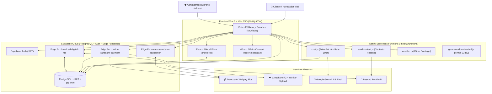

# 🦊 Informe de Arquitectura y Reporte Técnico — La Casa de Zolve

**Entidad Legal:** La Casa de Zolve SpA (RUT `77.446.775-0`)  
**Dominio Principal:** https://lacasadezolve.com  
**Última Actualización:** 12 de noviembre de 2026  

---

## 1. Visión General y Stack Tecnológico

**La Casa de Zolve** es una plataforma de comercio electrónico (*e-commerce*) chilena híbrida (productos físicos personalizados/a pedido, packs mayoristas/freebies de impresión y productos digitales descargables) construida bajo una arquitectura **JAMstack / Serverless** de alto rendimiento y bajo costo operativo.

| Capa | Tecnología | Rol Principal |
| :--- | :--- | :--- |
| **Frontend & Pre-renderizado** | **Vue 3 (Composition API) + Vite 6 + `vite-ssg`** | SPA reactiva con generación de páginas estáticas (SSG) para SEO y indexación rápida en Google. |
| **Gestión de Estado** | **Pinia** + `pinia-plugin-persistedstate` | Estado reactivo de autenticación, catálogo, carrito persistente, cupones y banners. |
| **Animaciones e Interfaz** | **GSAP (`ScrollTrigger`) + CSS Scoped** | Efectos *scroll stacking* adaptativos (desktop/móvil), *typewriter* en Hero y transiciones fluidas. |
| **Base de Datos y Auth** | **Supabase (PostgreSQL + GoTrue + RLS + `pg_cron`)** | Base de datos relacional, autenticación JWT, funciones RPC seguras (`SECURITY DEFINER`) y tareas programadas. |
| **Hosting & Serverless API** | **Netlify (CDN + Netlify Functions Node.js)** | Despliegue continuo desde GitHub, funciones backend para ZolveBot (Gemini), formulario de contacto (Resend), clima (OpenWeather) y URLs firmadas. |
| **Edge Functions Transaccionales** | **Supabase Edge Functions (Deno)** | Creación y confirmación de transacciones **Transbank Webpay Plus**, envío de correos post-compra y descarga directa de archivos digitales. |
| **Almacenamiento de Archivos** | **Cloudflare R2 + Cloudflare Worker Presigner** | Bucket S3-compatible para imágenes de catálogo (`.webp`), archivos adjuntos de clientes y PDFs digitales descargables. |
| **Analítica y Privacidad** | **Google Analytics 4 (`G-209MS94TPM`) + Consent Mode v2** | Medición de eventos de e-commerce (`purchase`) con consentimiento granular por categorías (*Esenciales*, *Analíticas*, *Marketing*). |

---

## 2. Diagrama de Arquitectura del Sistema

---

## 3. Mapa de Módulos del Frontend (`src/`)

### 3.1. Vistas Públicas y de Compra (`src/views/`)
| Archivo | Ruta | Responsabilidad Principal |
| :--- | :--- | :--- |
| `HomeView.vue` | `/` | Portada principal: Hero animado con GSAP, carrusel de banners (`BannerCarousel`), productos destacados, tarjetas de acceso a Especiales/Freebies y formulario de contacto. |
| `StoreView.vue` | `/tienda` | Catálogo general con búsqueda con *debounce*, filtro por categorías de BD y categoría inteligente **`🎁 Freebies / Por Mayor`** (`?categoria=freebies_mayorista`), ordenamiento y paginación. |
| `ProductDetailView.vue` | `/producto/:id` | Ficha de producto con galería, selector de tallas, configurador de packs mayoristas (`SelectorPacksMayorista`), subida de archivos a Cloudflare R2 (`FileUploads`), notas de personalización y JSON-LD de producto. |
| `BTSChileView.vue` | `/especiales-y-freebies` | Landing interactiva con `StackSection` y GSAP para Freebies K-Pop (conciertos, cumpleaños, juntas, pymes), entradas conmemorativas, planners y ropa. |
| `CartView.vue` | `/carrito` | Gestión del carro de compras, validación de stock en tiempo real contra Supabase, cálculo de promociones 2x en tickets y aplicación de cupones de descuento. |
| `CheckoutView.vue` | `/checkout` | Formulario de despacho con validación de RUT, autocompletado desde el perfil, **cálculo dinámico de envío** (Paket $3.500 en RM / Starken por pagar en regiones / $0 si es 100% digital), aceptación expresa de T&C y apertura de Webpay Plus. |
| `PaymentReturnView.vue` | `/payment-return` | Ventana puente que recibe `token_ws` desde Transbank, invoca `confirm-transbank-payment` y notifica a la ventana principal (`postMessage` o redirección directa). |
| `OrderConfirmationView.vue` | `/confirmacion-pedido/:orderId` | Resumen de pago exitoso, disparo deduplicado del evento `purchase` a GA4 y **descarga inmediata en pantalla** de archivos digitales comprados. |
| `AuthView.vue` / `UpdatePasswordView.vue` | `/ingreso`, `/actualizar-contrasena` | Inicio de sesión, registro con casilla obligatoria de Privacidad/Términos y recuperación de contraseña vía Supabase Auth. |
| `ProfileView.vue` / `OrderDetail.vue` | `/mi-perfil`, `/orden/:orderId` | Datos de contacto/envío minimizados, sección **"📥 Mis Descargas Digitales"**, historial de pedidos con descarga directa y **switch de eliminación definitiva de cuenta** (Ley N° 21.719). |
| `LinksView.vue` | `/links` | Árbol de enlaces rápidos para biografía de Instagram/TikTok. |
| `TermsConditionsView.vue`, `PrivacyPolicyView.vue`, `CookiesPolicyView.vue` | `/terminos-y-condiciones`, `/politica-de-privacidad`, `/politica-de-cookies` | Marco legal actualizado a la **Ley N° 21.719**, **Ley N° 19.628** y **Ley N° 19.496** (SERNAC). |

### 3.2. Panel de Administración (`src/views/Admin/`)
Protegido por el *navigation guard* `requiresAdmin: true` en `src/router/index.js` (verifica `profiles.role === 'admin'`):
- **Catálogo:** `AdminProductListView.vue`, `AdminProductFormView.vue` (creación/edición de productos físicos, packs mayoristas, tickets y archivos digitales con subida a Cloudflare R2), `AdminProductCategoriesView.vue`, `AdminFeaturedProductsView.vue`.
- **Ventas y Marketing:** `AdminOrdersListView.vue`, `AdminOrderDetailView.vue` (cambio de estados de pedido, visualización de archivos subidos por el cliente y notas de personalización), `AdminCouponsView.vue`, `AdminBannersView.vue`.
- **Usuarios:** `AdminUserListView.vue`.

### 3.3. Stores de Estado Global (`src/stores/`)
1. `authStore.js`: Sincroniza la sesión de Supabase Auth, carga el rol del usuario (`admin` / `customer`) y expone `signOut()`.
2. `storeProducts.js`: Consulta paginada a `products` con filtros por búsqueda, categoría numérica o filtro inteligente `freebies_mayorista` (`is_print_product = true`).
3. `storeCart.js`: Persistido en `localStorage`. Maneja ítems simples y variantes con metadatos (tallas, packs mayoristas, archivos personalizados), calcula descuentos promocionales de tickets y detecta si el pedido requiere envío físico (`requiresShipping`) o es 100% digital (`hasDigitalProducts`).
4. `storeCoupons.js` y `storeBanners.js`: Validación de cupones activos y carga de banners de portada.

### 3.4. Analítica y Consentimiento (`src/ga4/`)
- `src/ga4/index.js`: Inicializa Google Consent Mode v2 con todo denegado por defecto (`denied`), restaura o guarda las preferencias del usuario (`zolve_cookie_consent_v2` en `localStorage`), sincroniza vistas de página con el router y expone `trackPurchase(order)` (con deduplicación para no contar dos veces la misma orden si el usuario recarga la página).
- `src/ga4/CookieConsentBanner.vue`: Banner inferior con botones **"Aceptar todas"**, **"Solo esenciales"** y submenú **"⚙️ Configurar"** (switches independientes para *Analíticas/GA4* y *Campañas/Redes Sociales*), reabrible en cualquier momento desde el pie de página (`🍪 Configurar Cookies`).

---

## 4. Flujos Críticos y Cómo se Comunican los Módulos

### 4.1. Flujo de Checkout, Pago con Webpay Plus y Descuento de Stock
> **Regla de Integridad de Inventario:** El stock **NUNCA** se descuenta cuando se crea la orden en estado `pending`. Solo se descuenta cuando Transbank confirma el pago exitoso (`status = 'paid'`). Si el pago falla o se abandona, el stock permanece intacto.

1. `CheckoutView.vue` verifica stock actual en Supabase e inserta la orden en estado `pending` junto con sus `order_items`.
2. `CheckoutView.vue` invoca la Supabase Edge Function `create-transbank-transaction`, que crea la sesión en Transbank Webpay Plus y devuelve `{ token, url }`.
3. El cliente completa el pago en Transbank y es redirigido a `/payment-return?token_ws=...` (`PaymentReturnView.vue`).
4. `PaymentReturnView.vue` llama a la Edge Function `confirm-transbank-payment`:
   - **Si Transbank aprueba (`response_code === 0`):** actualiza la orden a `status = 'paid'`, ejecuta `decrement_product_stock`, envía el correo de confirmación vía Resend y redirige a `/confirmacion-pedido/:orderId`.
   - **Si Transbank rechaza o el usuario anula:** actualiza la orden a `status = 'failed'` sin tocar el stock.

### 4.2. Flujo de Productos Digitales y Descarga Directa (En Web + Correo)
Cuando un producto tiene `is_downloadable = true`:
1. **En el Carrito y Checkout:** Si todos los productos del carrito son digitales (`requiresShipping === false`), el Checkout **oculta los campos de dirección física** y asigna costo de envío **$0**.
2. **Al Confirmar el Pago:**
   - **Por Correo:** Se envía automáticamente un correo al comprador con el enlace de descarga.
   - **En la Misma Página Web (3 lugares habilitados, exclusivos para productos digitales):**
     1. **Pantalla post-pago (`OrderConfirmationView.vue`):** Aparece la caja morada **"📥 Tus Archivos Digitales"** con el botón **"Descargar Archivo"**.
     2. **Mi Perfil (`ProfileView.vue`):** Sección **"📥 Mis Descargas Digitales"** con acceso a sus archivos comprados.
     3. **Detalle del Pedido (`OrderDetail.vue`):** Botón **"📥 Descargar Archivo Digital"** junto al producto dentro del detalle de la orden.
3. **Seguridad de la Descarga (`download-digital-file`):**
   - Al hacer clic en cualquiera de esos botones, se invoca `${VITE_SUPABASE_URL}/functions/v1/download-digital-file?item_id=${orderItemId}`.
   - La función valida en Supabase que la orden esté pagada (`paid`, `processing`, `shipped` o `delivered`), registra/verifica el contador en la tabla `user_digital_downloads` (máximo 5 descargas por compra), obtiene el PDF desde **Cloudflare R2** y lo entrega con cabecera `Content-Disposition: attachment; filename="..."` para que se guarde directo en el dispositivo.

### 4.3. Flujo de ZolveBot (Asistente Virtual con IA)
1. El componente flotante `ZolveBotChat.vue` carga el catálogo activo desde Supabase (calculando precios vigentes, packs mayoristas y disponibilidad) y lo envía junto con la consulta del usuario a `/.netlify/functions/chat`.
2. La función serverless `netlify/functions/chat.js`:
   - Aplica **Rate Limiting por IP** mediante el RPC `check_rate_limit` en Supabase (máximo 10 mensajes por minuto por IP) para proteger tu cuota de API.
   - Sanitiza el historial y construye un *System Prompt* con las reglas reales de negocio (envío Paket $3.500 en RM, Starken por pagar en regiones, preparación de 2 a 3 días hábiles y hasta 5 en alta demanda, pago exclusivo por Webpay Plus).
   - Consulta el modelo **Gemini 2.5 Flash** (`@google/genai`) en tiempo real **sin almacenar las conversaciones en la base de datos** (cumpliendo con el principio de minimización de datos de la Ley N° 21.719).

---

## 5. Base de Datos en Supabase (Tablas, RPCs y Automatizaciones)

### 5.1. Tablas Principales (`public`)
- `products`: Catálogo completo (`price`, `offer_price`, `discount_percentage`, `stock`, `is_customizable`, `has_sizes`, `is_event_ticket`, `is_print_product`, `print_quantity_packages`, `available_print_designs`, `is_downloadable`, `downloadable_file_url`, `original_file_name`, `category_id`).
- `product_categories`: Categorías del catálogo.
- `orders`: Cabecera de pedidos (`user_id`, `customer_name`, `customer_email`, `customer_phone`, `customer_rut`, `shipping_address`, `total_amount`, `discount_amount`, `applied_coupon_code`, `status`, `payment_method`, `payment_info`, `customization_notes`).
- `order_items`: Detalle por línea de pedido (`order_id`, `product_id`, `quantity`, `price_at_purchase`, `metadata`).
- `user_digital_downloads`: Control de descargas digitales (`order_id`, `product_id`, `user_id`, `downloads_count`, `max_downloads`, `expires_at`).
- `profiles`: Datos de usuarios registrados (`id`, `first_name`, `last_name`, `rut`, `phone`, `shipping_address`, `avatar_url`, `role`).
- `coupons`: Cupones de descuento (`code`, `discount_type`, `discount_value`, `min_purchase_amount`, `max_uses`, `current_uses`, `expires_at`, `is_active`).
- `banners` y `featured_products`: Gestión visual de la portada.

### 5.2. Funciones RPC y Automatizaciones (`pg_cron`)
Definidas en Supabase (y respaldadas en `supabase_delete_account_rpc.sql` y `supabase_rate_limit.sql`):
1. `decrement_product_stock`: Descuenta el stock de productos físicos únicamente al confirmarse el pago.
2. `check_rate_limit`: Protege los endpoints serverless contra abuso por IP.
3. `delete_user_account()`: Permite que el propio usuario autenticado elimine de raíz su perfil y su cuenta en `auth.users` desde *Mi Perfil* (Derecho de Supresión — Ley N° 21.719).
4. `cleanup_inactive_accounts()` + **Job `pg_cron` (`cleanup-inactive-accounts-12m`)**: Se ejecuta automáticamente el día 1 de cada mes a las 03:00 UTC y elimina las cuentas de clientes sin inicio de sesión ni compras durante más de **12 meses**.

---

## 6. Variables de Entorno y Servicios Externos

| Variable | Dónde vive | Propósito |
| :--- | :--- | :--- |
| `VITE_SUPABASE_URL` | Frontend / Netlify | URL del proyecto Supabase (`https://iiukewazntbkoirpizdy.supabase.co`). |
| `VITE_SUPABASE_ANON_KEY` | Frontend / Netlify | Clave pública anónima de Supabase (protegida por políticas RLS). |
| `SUPABASE_SERVICE_ROLE_KEY` | Netlify Functions (Backend) | Clave administrativa de Supabase para `generate-download-url.js` y `chat.js`. |
| `ZOLVE_GEMINI_API_KEY` | Netlify Functions (Backend) | API Key de Google Gemini para ZolveBot (`chat.js`). |
| `RESEND_API_KEY` | Netlify / Supabase Edge | Envío de correos transaccionales y formulario de contacto (`send-contact.js`). |
| `OPENWEATHER_API_KEY` | Netlify Functions (Backend) | Widget de clima en Santiago (`weather.js`). |
| `R2_ACCOUNT_ID`, `R2_ACCESS_KEY_ID`, `R2_SECRET_ACCESS_KEY`, `R2_BUCKET_NAME` | Netlify / Supabase Edge | Credenciales del bucket Cloudflare R2 (`lacasadezolve`) para firmas de descarga. |
